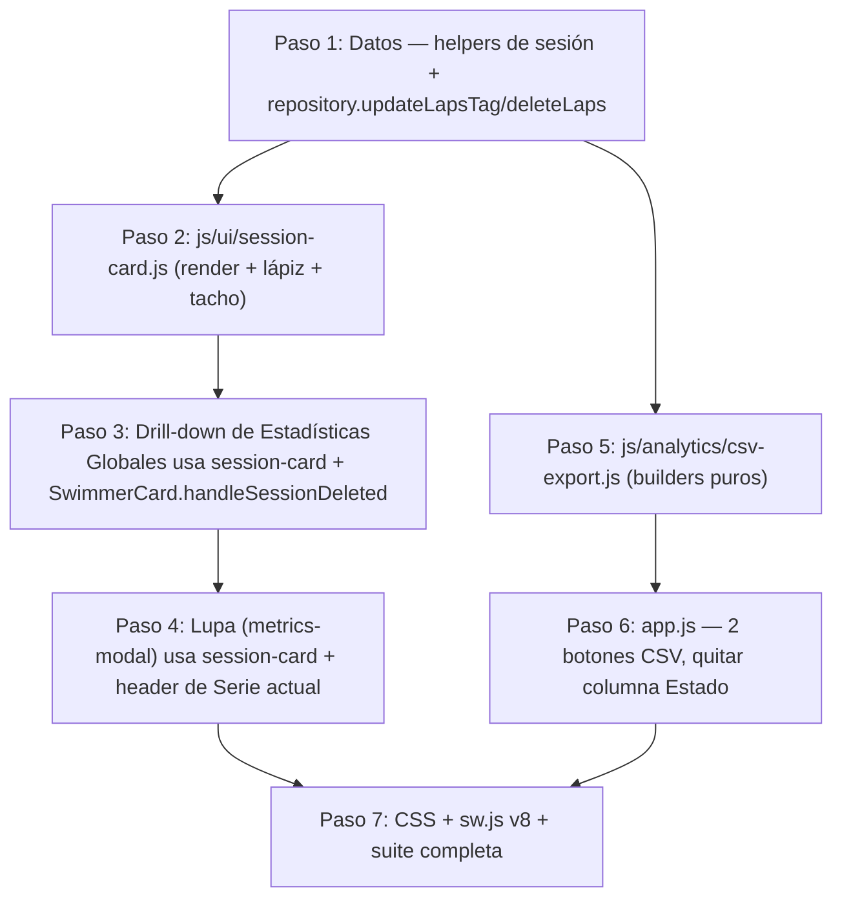

# Plan: CSV legible, etiquetas por sesión y borrado por sesión

> **Cómo usar este plan (iterando con `/clear`):** en cada iteración enviar:
> ```text
> Lee @tasks/plan.md y @tasks/todo.md. Ejecuta ÚNICAMENTE el Paso N del plan.
> Respeta las Invariantes y Casos Borde de ese paso, corre su comando de verificación, marca las casillas en tasks/todo.md y detente.
> ```
> Plan anterior (completado): `tasks/archive/2026-10-01-refactor-plan.md`.

---

## Análisis crítico del CSV actual (`swimcoach-dataset-2026-10-17.csv`)

| Problema | Evidencia | Propuesta |
|---|---|---|
| Los tiempos están en ms crudos | `Parcial (ms)=63956` | `01:03.96` para leer + `63,96` (segundos con coma decimal, numérico en Excel ES) |
| `Estado` no aporta nada | siempre `Detenido`: es un snapshot del reloj en vivo | **Eliminar** (y también de la tabla de Estadísticas Globales) |
| `Tiempo actual` / `Tiempo actual (ms)` engañan | es el reloj *en vivo* de la tarjeta, repetido en cada fila y sin relación con sesiones viejas | **Eliminar**; se reemplaza por `Total` por sesión |
| Fecha en UTC ISO | `2026-10-17T00:02:49Z` cuando localmente era 16/10 21:02 | Fecha local `2026-10-16` + hora local `21:02` |
| El nombre del archivo también usa la fecha UTC | `swimcoach-dataset-2026-10-17.csv` exportado el 16/10 | Fecha local en el nombre |
| `ID Nadador` es ruido interno | `swimmer-1792195128609-impjl` | **Eliminar** (el nombre ya identifica) |
| No hay identificador de sesión | hay que deducirlo de `Pase` = 1 | Columnas `Fecha` + `Hora inicio` + `Etiqueta` |
| Formato largo (1 fila por pase): difícil de leer | 2 filas por nadador para una sola serie | **CSV resumen**: 1 fila por sesión y los pases en columnas (`Pase 1`, `Pase 2`…) |

**Así queda el CSV resumen con los mismos datos** (14 filas en vez de 35; el nombre es ilustrativo):

```text
Fecha;Hora inicio;Carril;Nadador;Etiqueta;Pases;Total;Total (s);Mejor;Mejor (s);Promedio;Promedio (s);Pase 1;Pase 2
2026-10-16;21:02;1;Juan Pérez;4x100 libre;2;02:06.86;126,86;01:02.91;62,91;01:03.43;63,43;01:03.96;01:02.91
```

---

## Decisiones de diseño (ya acordadas)

1. **Dónde se guarda la etiqueta:** como `lap.sessionTag` en **todos** los pases de la sesión. No se toca el esquema de IndexedDB (sigue en `DB_VERSION = 1`, sin migración). Las sesiones se siguen deduciendo con `partitionLapsIntoSessions`. Para leer la etiqueta de una sesión se usa el primer `sessionTag` no vacío entre sus pases, así que los pases que se agreguen después de etiquetar igual la muestran.
2. **Clave de sesión:** `session[0].id` (el id del primer pase). Se usa solo en el DOM (`data-session-key`) para encontrar la sesión al hacer click.
3. **Borrar una sesión:** borra de IndexedDB sus pases. Si alguno de esos pases está en `card.laps` (es la serie activa de la tarjeta), la tarjeta se reinicia con `handleReset()` sin `clearHistorical`.
4. **El botón rojo actual "Borrar sesión"** (`#metrics-reset-session`) en realidad borra *todo* el historial. Pasa a llamarse **"Borrar todo el historial"** (el id no cambia) para no confundirlo con el nuevo tacho por sesión.
5. **Edición de la etiqueta con input inline:** Enter o blur guarda, Esc cancela. Máximo 60 caracteres, con trim. Un texto vacío borra la etiqueta.
6. **Un solo renderizador de tarjetas de sesión** (`js/ui/session-card.js`) compartido por la Lupa y por el drill-down de Estadísticas Globales. Hoy ese HTML está duplicado en los dos lados.

> [!IMPORTANT]
> **Invariante de tests:** la etiqueta de apertura debe quedar exactamente como `<div class="drilldown-session-card">`, sin atributos extra, porque `challenger_m2_empirical.test.js` hace `split` sobre ese string. Los `data-*` van en los botones. Además, el texto `N pases` tiene que seguir dentro de cada tarjeta.

> [!WARNING]
> **Limitación conocida:** si se etiqueta una sesión en curso y después se borran *todos* los pases etiquetados, dejando solo los nuevos, la etiqueta se pierde. Es aceptable para la v1.

---

## Grafo de dependencias



---

## Paso 1: Helpers de sesión y operaciones por lote en el repositorio

**Archivos:** `js/analytics/session-partitioner.js`, `js/storage/repository.js`, `tests/unit/analytics.test.js`, `tests/unit/storage.test.js`

1. En `session-partitioner.js`, agregar estos exports (sin tocar las funciones que ya existen):
   ```js
   export const SESSION_TAG_MAX_LENGTH = 60;
   export function normalizeSessionTag(raw) {
     return String(raw ?? '').replace(/\s+/g, ' ').trim().slice(0, SESSION_TAG_MAX_LENGTH);
   }
   export function getSessionTag(session) {
     if (!Array.isArray(session)) return '';
     for (const lap of session) {
       const t = normalizeSessionTag(lap?.sessionTag);
       if (t) return t;
     }
     return '';
   }
   export function getSessionKey(session) {
     return (Array.isArray(session) && session[0]?.id) ? String(session[0].id) : '';
   }
   ```
2. En `repository.js`, agregar dos métodos a `SwimmerRepository`, usando `get`, `put` y `deleteItem`, que ya están importados:
   ```js
   async updateLapsTag(lapIds, tag) {
     const clean = normalizeSessionTag(tag);          // import desde ../analytics/session-partitioner.js
     for (const id of (lapIds || [])) {
       const lap = await get(STORES.LAPS, id);
       if (!lap) continue;
       if (clean) lap.sessionTag = clean; else delete lap.sessionTag;
       await put(STORES.LAPS, lap);
     }
     return clean;
   }
   async deleteLaps(lapIds) {
     for (const id of (lapIds || [])) { if (id) await deleteItem(STORES.LAPS, id); }
   }
   ```
3. Tests:
   - `analytics.test.js`: `normalizeSessionTag` (trim, colapsa espacios, corta a 60, `null` → `''`); `getSessionTag` devuelve el primer tag no vacío; `getSessionKey` devuelve `''` para una sesión vacía.
   - `storage.test.js` (usar el mismo setup que el archivo, con fake-indexeddb o memoria): guardar 3 pases → `updateLapsTag([id1,id2], '  200 m  espalda ')` → `getLaps` devuelve `sessionTag === '200 m espalda'` en esos 2 pases y nada en el 3.º; `updateLapsTag([id1], '')` borra la propiedad; `deleteLaps([id1,id3])` deja solo `id2`.

**Verificación:** `node --test tests/unit/analytics.test.js tests/unit/storage.test.js`

---

## Paso 2: Renderizador compartido de tarjetas de sesión (`js/ui/session-card.js`)

**Archivos:** [NEW] `js/ui/session-card.js`, [NEW] `tests/unit/session_card.test.js`

Exports:

```js
export function escapeHtml(str)                       // copia exacta de AppCoordinator._escapeHtml
export function formatSessionDate(timestamp, fallback) // toLocaleDateString('es-ES',{day:'2-digit',month:'short',hour:'2-digit',minute:'2-digit'}) o fallback
export function renderSessionMetaHTML(session, { fallbackLabel })  // fila: fecha + etiqueta + lápiz | "N pases" + tacho
export function renderSessionCardHTML(session, { fallbackLabel, baseline, globalMin, globalMax })
export function bindSessionCardActions(containerEl, sessions, { onTag, onDelete })
```

`renderSessionMetaHTML` devuelve este markup (la etiqueta va escapada con `escapeHtml`):

```html
<div class="drilldown-session-meta">
  <div class="session-title" data-session-key="KEY">
    <strong>${dateLabel}</strong>
    ${tag ? `<span class="session-tag">${escapeHtml(tag)}</span>` : ''}
    <button type="button" class="btn-icon btn-session-tag" data-session-key="KEY"
            aria-label="Etiquetar sesión" title="Etiquetar sesión"><!-- svg lápiz --></button>
  </div>
  <div class="session-meta-right">
    <span>${n} ${n === 1 ? 'pase' : 'pases'}</span>
    <button type="button" class="btn-icon btn-session-delete" data-session-key="KEY"
            aria-label="Borrar sesión" title="Borrar sesión"><!-- svg tacho, igual al de .btn-lap-delete --></button>
  </div>
</div>
```

SVG del lápiz (estilo Feather, igual que el resto de los íconos):
`<svg width="14" height="14" viewBox="0 0 24 24" fill="none" stroke="currentColor" stroke-width="2" stroke-linecap="round" stroke-linejoin="round"><path d="M12 20h9"/><path d="M16.5 3.5a2.121 2.121 0 0 1 3 3L7 19l-4 1 1-4L16.5 3.5z"/></svg>`

`renderSessionCardHTML` devuelve exactamente lo que hoy arma `showSwimmerDrillDown` en `js/app.js` (líneas 474–518): `<div class="drilldown-session-card">` + `renderSessionMetaHTML(...)` + `.drilldown-session-stats` (Mejor / Ritmo) + `.drilldown-session-chart` con `renderBoxplotSVG(splitsSeconds, { baseline, width: 440, height: 75, globalMin, globalMax })`.

`bindSessionCardActions(containerEl, sessions, handlers)`:
- Arma un `Map` de `getSessionKey(s)` → `s`.
- **`.btn-session-tag` click** (`preventDefault` + `stopPropagation`): busca el `.session-title[data-session-key=KEY]`, guarda su `innerHTML` original y lo reemplaza por `<input type="text" class="session-tag-input" maxlength="60" placeholder="Ej: 4x100 libre, técnica brazada" value="${escapeHtml(getSessionTag(session))}">`, y después hace `focus()` y `select()` si existen.
  - `keydown` Enter → `commit()`; Escape → restaurar el `innerHTML` original (cancelar).
  - `blur` → `commit()`.
  - `commit()` tiene un guard `let done = false` para que Enter seguido de blur no guarde dos veces. Llama `await handlers.onTag(session, normalizeSessionTag(input.value))`. El caller se encarga de re-renderizar.
- **`.btn-session-delete` click:** `window.confirm(\`¿Borrar la sesión del ${dateLabel} (${n} pases)? Esta acción no se puede deshacer.\`)` → si se confirma, `await handlers.onDelete(session)`.

Tests (`session_card.test.js`; copiar el mock de DOM que ya usa `metrics_modal.test.js`):
- La tarjeta empieza con `<div class="drilldown-session-card">`, contiene `2 pases`, `btn-session-tag`, `btn-session-delete` y la etiqueta escapada (`<b>` → `&lt;b&gt;`).
- Sin etiqueta no se renderiza `.session-tag`.
- Click en el tacho con `window.confirm = () => true` → se llama `onDelete` con la sesión correcta; con `false` → no se llama.
- Click en el lápiz → aparece `.session-tag-input`; simular `keydown` Enter con valor `' 8x50 '` → `onTag(session, '8x50')` se llama **una sola vez**, aunque después llegue un `blur`. Si el mock no soporta `focus`/eventos de input, extenderlo de forma mínima en el propio test.

**Verificación:** `node --test tests/unit/session_card.test.js tests/unit/boxplot.test.js`

---

## Paso 3: Drill-down de Estadísticas Globales con etiqueta y borrado + `SwimmerCard.handleSessionDeleted`

**Archivos:** `js/app.js`, `js/ui/swimmer-card.js`, `tests/unit/feature4_drilldown.test.js`, `tests/unit/swimmer_card.test.js`

1. `swimmer-card.js`, nuevo método (agregar el bind en el constructor, junto a los demás):
   ```js
   async handleSessionDeleted(lapIds) {
     const ids = new Set(lapIds || []);
     if (!this.laps.some(l => ids.has(l.id))) return false;
     await this.handleReset();   // sin clearHistorical: los pases ya fueron borrados
     return true;
   }
   ```
2. `app.js` → `showSwimmerDrillDown`: reemplazar el map de `recentSessions` (líneas 474–518) por
   `renderSessionCardHTML(session, { fallbackLabel: \`Sesión ${sessions.length - sIdx}\`, baseline: baselineVal, globalMin, globalMax })`.
   Después de asignar `contentEl.innerHTML`, llamar a:
   ```js
   bindSessionCardActions(contentEl, recentSessions, {
     onTag: async (session, tag) => {
       await repository.updateLapsTag(session.map(l => l.id), tag);
       await this.showSwimmerDrillDown(swimmerId);
     },
     onDelete: async (session) => {
       const ids = session.map(l => l.id);
       await repository.deleteLaps(ids);
       const card = this.cards.get(swimmerId);
       if (card) await card.handleSessionDeleted(ids);
       await this.showSwimmerDrillDown(swimmerId);
     }
   });
   ```
   Reemplazar `this._escapeHtml` por el `escapeHtml` importado. `_escapeHtml` se puede dejar delegando al import para no romper el bind del constructor.
3. Tests:
   - `TC-DD-408`: 2 sesiones guardadas → `showSwimmerDrillDown` → click en el lápiz de la primera tarjeta + Enter con `'Técnica'` → todos los pases de esa sesión en el repo tienen `sessionTag === 'Técnica'` y el HTML re-renderizado incluye `<span class="session-tag">Técnica</span>`.
   - `TC-DD-409`: con `confirm → true`, click en el tacho de una sesión → el repo pierde solo esos pases y se renderiza 1 `.drilldown-session-card`.
   - `TC-SC-213` (`swimmer_card.test.js`): `handleSessionDeleted` con ids de `card.laps` → estado `IDLE` y `laps = []`; con ids ajenos → devuelve `false` y no cambia nada.

**Verificación:** `node --test tests/unit/feature4_drilldown.test.js tests/unit/challenger_m2_empirical.test.js tests/unit/swimmer_card.test.js`

---

## Paso 4: Lupa (Métricas Individuales) con etiqueta y borrado por sesión

**Archivos:** `js/ui/metrics-modal.js`, `js/ui/swimmer-card.js`, `tests/unit/metrics_modal.test.js`

1. `_renderBody`:
   - **Series Anteriores:** usar `renderSessionCardHTML(session, { fallbackLabel: \`Serie ${previousSessions.length - pIdx}\`, baseline, globalMin, globalMax })` (se va todo el bloque duplicado de las líneas 301–344).
   - **Serie actual:** si `currentSession.length > 0`, anteponer a `metricsHTML`:
     ```html
     <div class="modal-section-title">Serie actual</div>
     <div class="current-session-meta">${renderSessionMetaHTML(currentSession, { fallbackLabel: 'Serie actual' })}</div>
     ```
   - Después de asignar `innerHTML`, llamar a `bindSessionCardActions(this.bodyEl, [currentSession, ...previousSessions].filter(s => s.length), { onTag, onDelete })`:
     - `onTag(session, tag)`: `await repository.updateLapsTag(ids, tag)`; en `this.laps`, poner o quitar `sessionTag` en los pases con esos ids; `this._renderBody(this.swimmer, this.laps)`.
     - `onDelete(session)`: `await repository.deleteLaps(ids)`; `this.laps = this.laps.filter(l => !ids.has(l.id))`; `await this.callbacks.onDeleteSession?.(ids)`; re-render.
   - Renombrar el texto del botón `#metrics-reset-session` a **"Borrar todo el historial"** y su confirm a `¿Borrar TODO el historial de pases de ${swimmerName}? …`.
2. `swimmer-card.js` → callbacks de la Lupa (alrededor de la línea 264), agregar:
   ```js
   onDeleteSession: async (ids) => {
     const set = new Set(ids);
     allLaps = allLaps.filter(l => !set.has(l.id));
     await this.handleSessionDeleted(ids);
   },
   ```
3. Invariantes: `TC-MM-301`..`309` siguen en verde (texto `"Sin pases registrados aún."`, `Series Anteriores (N)`, `.btn-lap-delete`, `#metrics-modal-reset`).
4. Tests nuevos:
   - `TC-MM-310`: con 2 series, etiquetar la serie actual desde `.current-session-meta .btn-session-tag` → `this.laps` y el repo tienen el tag, y el HTML muestra `.session-tag`.
   - `TC-MM-311`: borrar una serie anterior con su tacho → desaparece `Series Anteriores` y `onDeleteSession` recibe sus ids.

**Verificación:** `node --test tests/unit/metrics_modal.test.js tests/unit/swimmer_card.test.js`

---

## Paso 5: Builders puros del CSV (`js/analytics/csv-export.js`)

**Archivos:** [NEW] `js/analytics/csv-export.js`, [NEW] `tests/unit/csv_export.test.js`

Entrada: `entries = [{ swimmer, laps }]`. Todo es puro y sin DOM.

```js
export function secondsEs(ms)        // (ms/1000).toFixed(2).replace('.', ',')      63956 → "63,96"
export function localDate(ts)        // YYYY-MM-DD con getters locales (getFullYear/getMonth/getDate)
export function localTime(ts, withSeconds = false) // HH:MM o HH:MM:SS local
export function buildSummaryRows(entries)  // → Array<Array<string|number>> incluyendo header
export function buildDetailRows(entries)
export function rowsToCsv(rows)      // BOM + ';' + '\r\n' + el csvEscape actual de app.js (movido aquí)
```

Los tiempos legibles se formatean con `formatTime` de `../timing/timer-engine.js` (`mm:ss.cc`).

**Resumen** (1 fila por sesión; sesiones vía `partitionLapsIntoSessions`):
`Fecha;Hora inicio;Carril;Nadador;Etiqueta;Pases;Total;Total (s);Mejor;Mejor (s);Promedio;Promedio (s);Pase 1..Pase N`
- `Total` = suma de los `splitDurationMs` de la sesión. `Promedio` = Total / pases (redondeado en ms).
- `N` = el `lapNumber` máximo entre todas las sesiones exportadas. La columna `Pase k` toma el pase con `lapNumber === k`. Si falta, la celda queda vacía (así se respetan los huecos que dejan los pases borrados).
- Filas ordenadas por `timestamp` del primer pase ↑, luego carril ↑, luego nombre.
- Los nadadores sin pases no generan fila.

**Detallado** (1 fila por pase):
`Fecha;Hora inicio;Hora pase;Carril;Nadador;Etiqueta;Pase;Parcial;Parcial (s);Acumulado;Acumulado (s)`
- `Etiqueta` = `getSessionTag(session)` (la etiqueta de la sesión, no la de cada pase). El orden es el mismo que en el resumen y, dentro de cada sesión, por `lapNumber`.

Tests (con timestamps construidos con `new Date(2026, 9, 16, 21, 2, 49).getTime()` para que no dependan de la zona horaria; los valores salen del CSV real):
- 2 nadadores (`'Juan Pérez'` carril 1, `'Ana'` carril 2), sesión 1 de Juan etiquetada `'4x100 libre'` con splits `63956, 62907`.
- Resumen: header correcto; fila `['2026-10-16','21:02',1,'Juan Pérez','4x100 libre',2,'02:06.86','126,86','01:02.91','62,91','01:03.43','63,43','01:03.96','01:02.91']`.
- Un hueco por pase borrado (`lapNumber` 1 y 3) deja la celda `Pase 2` en `''`.
- Detallado: 1 fila por pase, sin columnas `Estado`, `Tiempo actual` ni `ID Nadador`.
- `rowsToCsv` empieza con `\uFEFF`, separa con `;` y escapa `"` y fórmulas (`=SUM` → `'=SUM`).

**Verificación:** `node --test tests/unit/csv_export.test.js`

---

## Paso 6: `app.js`: dos botones CSV y sin columna Estado

**Archivos:** `js/app.js`, `tests/unit/feature4_drilldown.test.js` (o un archivo nuevo `tests/unit/global_stats.test.js`)

1. En `_renderGlobalStatsView`:
   - Reemplazar el botón único por:
     ```html
     <button type="button" id="btn-export-csv-summary" class="btn-secondary">CSV resumen (por sesión)</button>
     <button type="button" id="btn-export-csv-detail" class="btn-secondary">CSV detallado (por pase)</button>
     ```
     y conectarlos a `this.exportCsv('summary')` y `this.exportCsv('detail')`.
   - Quitar `<th>Estado</th>`, la `<td>` del `status-indicator` y cambiar `colspan="6"` por `colspan="5"`.
2. Reescribir `exportCsv(mode = 'summary')`:
   - Arma `entries` como ahora (`repository.getLaps` con fallback a `card.laps` si la DB tiene menos pases).
   - `rows = mode === 'detail' ? buildDetailRows(entries) : buildSummaryRows(entries)`; `csv = rowsToCsv(rows)`.
   - Nombre del archivo: `swimcoach-${mode === 'detail' ? 'detalle' : 'resumen'}-${localDate(Date.now())}.csv`.
   - Quedan sin usar `TIMER_STATE_LABELS_ES` y `timerEngine.getElapsedMs` en el export: eliminar la constante si ya no se usa en ningún lado.
3. Test: `showGlobalStats()` → el HTML no contiene `<th>Estado</th>`, contiene los dos ids de botón, y la fila vacía usa `colspan="5"`.

**Verificación:** `node --test tests/unit/feature4_drilldown.test.js tests/unit/challenger_m2_empirical.test.js && node tests/verify_spanish.js`

---

## Paso 7: Estilos, Service Worker y validación end-to-end

**Archivos:** `css/styles.css`, `sw.js`

1. `styles.css` (usar solo variables que existan en `css/variables.css`):
   - `.session-title { display:flex; align-items:center; gap:var(--space-2); min-width:0; }`
   - `.session-meta-right { display:flex; align-items:center; gap:var(--space-2); }`
   - `.session-tag`: pill (padding 2px 8px, `border-radius:999px`, fondo de acento suave, `max-width:180px`, `overflow:hidden; text-overflow:ellipsis; white-space:nowrap`).
   - `.btn-session-tag, .btn-session-delete`: misma base que `.btn-lap-delete` (28×28). En hover, el tacho toma el color de peligro y el lápiz el de acento.
   - `.session-tag-input`: alto 28px, `font-size: var(--font-xs)`, borde `var(--border-default)`, `flex:1; min-width:120px`.
   - `.current-session-meta`: mismo fondo y borde que `.drilldown-session-card`, con padding `var(--space-2)`.
   - Target táctil ≥ 28px (uso en la pileta con el teléfono).
   - **Corrección de altura de la tabla de pases en el modal individual (`#metrics-modal`):**
     - Como `.modal-body` tiene `display: flex; flex-direction: column; overflow-y: auto`, los hijos con `overflow-y: auto` (`.laps-table-wrapper` y `.drilldown-sessions-stack`) tienen `flex-shrink: 1` y `min-height: 0` implícito, por lo que al aparecer `Series Anteriores` flexbox comprime `.laps-table-wrapper` a ~1 fila visible.
     - Agregar `flex-shrink: 0;` a `.modal-body > *` (evita que flexbox aplaste hijos dentro del contenedor scrolleable).
     - En `.laps-table-wrapper`: subir `max-height` de `180px` a `260px` y añadir `flex-shrink: 0;`.
     - En `#metrics-modal-body .drilldown-sessions-stack`: usar `max-height: none; overflow-y: visible;` para que el scroll vertical principal sea el de `#metrics-modal-body` y no queden dos áreas de scroll pequeñas compitiendo.
2. `sw.js`: `CACHE_NAME = 'swimcoach-v8'`; agregar `'./js/ui/session-card.js'` y `'./js/analytics/csv-export.js'` a `PRECACHE_URLS`.
3. Correr la suite completa. No puede quedar ningún fail ni skip; la base de partida son 170 tests en verde y ahora deben ser más.

**Verificación:** `npm test && npm run verify && node tests/verify_spanish.js`

### Verificación manual (usuario)
1. `npx serve .` (o el servidor habitual) → crear 2–3 nadadores, hacer 2 series.
2. Lupa → **Serie actual**: lápiz → escribir "4x100 libre" → Enter → aparece la pill. Recargar la página: la etiqueta persiste.
3. Series Anteriores → tacho → confirmar → la tarjeta desaparece. Si era la serie activa, el reloj vuelve a `00:00.00`.
4. Estadísticas Globales → nombre del nadador → mismo lápiz y tacho en cada boxplot.
5. La tabla ya no tiene columna Estado. Descargar los dos CSV y abrirlos en Excel/LibreOffice (locale ES): `Total (s)` suma como número y la etiqueta aparece en la columna `Etiqueta`.
